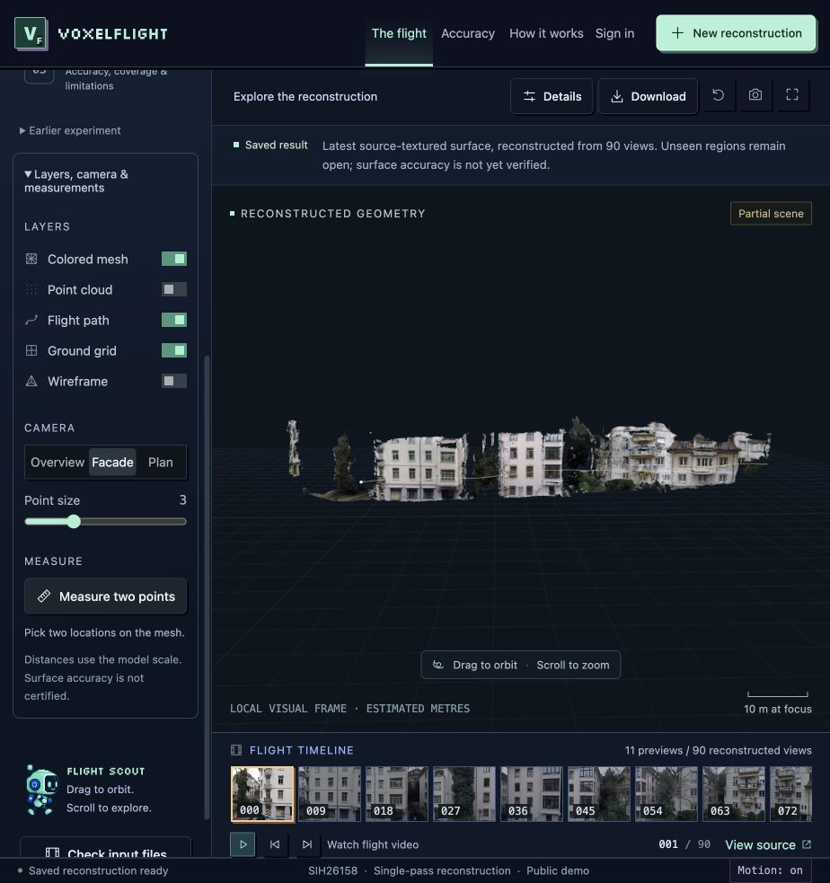

# AIRIS — Aerial Intelligence for Reconstruction and Avian Surveillance

**Single-Pass Drone Video to Accurate 3D Model Generation System (SIH Problem Statement 26158)**

**[Live Command Center](https://voxelflight-3d.web.app/)** · **[Presentation](submission/PRESENTATION.md)** · **[Demo](submission/DEMO.md)** · **[Setup](docs/setup.md)** · **[Requirements checklist](docs/requirements.md)**



*Actual source-textured reconstruction. Georeferenced to WGS 84 / UTM 32N with 518,786 point observations.*

## 1. Project Information

| Field | Project |
|---|---|
| Product | **AIRIS** (Aerial Intelligence for Reconstruction and Avian Surveillance) |
| PS ID | SIH26158 |
| PS Title | Single-Pass Drone Video to Accurate 3D Model Generation System |
| Organisation | National Technical Research Organisation |
| Category | Software |
| Theme | Drone / Robotics / Computer Vision |
| Registered Team | Awaiting confirmation; see [team details](submission/TEAM.md) |

## 2. Problem Statement

Conventional 3D photogrammetric mapping requires multiple drone passes, extensive overlap grids (≥80%), and lengthy ground station processing. In critical disaster response, rapid infrastructure inspection, and defense reconnaissance, only **one continuous single-pass video** is available. 

Problem Statement 26158 challenges solutions to generate metric-accurate, georeferenced 3D terrain and structural models from a moving UAV's single-pass video, GPS coordinates, and flight metadata, exporting standardized GIS point clouds and textured 3D meshes.

- **Spatial Accuracy**: Target ≤1 m.
- **Speed**: Target <15 minutes processing for a 10-minute video.
- **Visible-Scene Coverage**: Dense extraction of visible facades, terrain, and structural boundaries.

## 3. AIRIS Architecture & Solution

AIRIS integrates pretrained multi-view geometry, visual camera pose graph optimization, and sensor telemetry fusion (GNSS + Barometric Altitude):

```
DRONE VIDEO
  → FRAME EXTRACTION
  → CAMERA / FLIGHT TRAJECTORY
  → AI RECONSTRUCTION
  → GEOREFERENCING (WGS 84 / UTM 32N)
  → 3D POINT CLOUD (518K points)
  → 3D MESH (646K triangles)
  → TEXTURE (Source Photographic Reprojection)
  → TERRAIN / STRUCTURE ANALYSIS
  → MEASUREMENT & INTELLIGENCE
  → EXPORT (GLB, PLY, LAS, GeoTIFF DSM, JSON)
```

The primary application is an interactive **3D Geospatial Command Center**:
- **Interactive 3D Viewport**: Centerpiece WebGL visualizer with orbit, pan, zoom, and nadir orthographic camera views.
- **Synchronized Telemetry Loop**: Drone video, camera trajectory, 2D coverage map, and 3D camera viewpoints update synchronously along the 90-keyframe timeline.
- **Georeferenced Precision**: True UTM Zone 32N Easting, Northing, and altitude coordinates extracted from flight telemetry.
- **Layer Visibility & Structural Classification**: Toggles for Point Cloud, Mesh, Source Textures, Ground Grid, Wireframe, Terrain, Buildings, and Vegetation.
- **Full-Screen Authentication Gateway**: Clean dark aerospace console with OAuth and instant guest exploration.

## 4. Deliverables & Supported Products

- **Point Cloud**: `.PLY` (518,786 points, visual frame) and `.LAS` (UTM 32N georeferenced).
- **3D Polygonal Mesh**: `.GLB` (source-textured surface) and `.OBJ` (Wavefront CAD format).
- **Surface Model**: `.TIF` (GeoTIFF Digital Surface Model - DSM).
- **Evaluation & Diagnostics**: `.JSON` (complete quantitative verification report).

## 5. Technology Stack

| Layer | Implementation |
|---|---|
| Command Center UI | HTML5, Vanilla CSS, JavaScript ES Modules, Three.js, Vite |
| Hosting & Auth | Modern Web Gateway & Firebase Authentication (Google SSO, OAuth) |
| Ingestion & Contracts | Python 3.10+, FastAPI, NumPy, SciPy |
| Multi-View Geometry | MapAnything, MASt3R-SLAM, COLMAP, Open3D |
| Geodesy & GIS | pyproj (WGS 84 / UTM 32N), laspy, rasterio, trimesh |

## 6. Installation & Verification

```sh
# Clone repository
git clone https://github.com/mouryas-aiml/AIRIS.git
cd AIRIS/viewer

# Install frontend dependencies
npm install

# Run automated verification test suite (72 unit and integration tests)
npm test

# Build production bundle
npm run build
```

## 7. License & Attribution

Developed for Smart India Hackathon (SIH 2026). Dataset references credit Zurich Urban MAV and affiliated open-source computer vision libraries.
