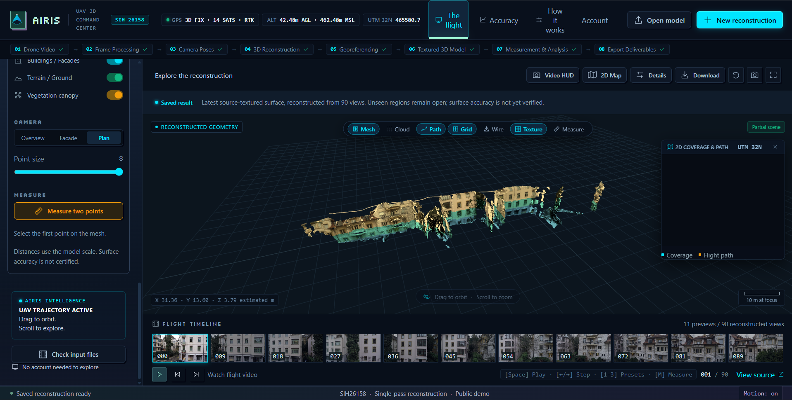

# AIRIS — Aerial Intelligence for Reconstruction and Avian Surveillance

**Single-Pass Drone Video → Accurate 3D Georeferenced Model** · Smart India Hackathon 2026 · Problem Statement **SIH26158**

[](https://github.com/mouryas-aiml/AIRIS/actions)
[](https://airis-3d.vercel.app/)
[](https://nodejs.org)
[](https://python.org)
[](LICENSE)

---

> **[🌐 Live Command Center](https://voxelflight-3d.web.app/)** — open immediately, no sign-in needed.
> Choose **Explore as a guest** to view the saved 90-view source-textured reconstruction, the original 60-second flight video, trajectory overlay, and all downloadable assets.

---


*Source-textured 3D reconstruction — 646,019 triangles, georeferenced to WGS 84 / UTM 32N*

---

## Table of Contents

1. [Project Information](#1-project-information)
2. [Problem Statement](#2-problem-statement)
3. [Architecture Overview](#3-architecture-overview)
4. [End-to-End Pipeline](#4-end-to-end-pipeline)
5. [AI/ML Models, Algorithms & Why We Chose Them](#5-aiml-models-algorithms--why-we-chose-them)
6. [Complete Technology Stack](#6-complete-technology-stack)
7. [Codebase Structure & Key Modules](#7-codebase-structure--key-modules)
8. [Deliverables & Output Formats](#8-deliverables--output-formats)
9. [Evaluation Metrics & Results](#9-evaluation-metrics--results)
10. [Installation & Setup](#10-installation--setup)
11. [Dataset](#11-dataset)
12. [CI/CD & Testing](#12-cicd--testing)
13. [Limitations & Honest Gaps](#13-limitations--honest-gaps)
14. [Future Scope & Potential Upgrades](#14-future-scope--potential-upgrades)
15. [Mentor-Level Q&A](#15-mentor-level-qa)
16. [Links & References](#16-links--references)

---

## 1. Project Information

| Field | Detail |
|---|---|
| **Product** | **AIRIS** (Aerial Intelligence for Reconstruction and Avian Surveillance) |
| **PS ID** | SIH26158 |
| **PS Title** | Single-Pass Drone Video to Accurate 3D Model Generation System |
| **Organisation** | National Technical Research Organisation |
| **Category** | Software |
| **Theme** | Drone / Robotics / Computer Vision |
| **Dataset** | Zurich Urban MAV (frames 61201–63000, official AGZ archive) |
| **Hosted** | [voxelflight-3d.web.app](https://voxelflight-3d.web.app/) (Firebase Hosting) |

---

## 2. Problem Statement

Conventional 3D photogrammetric pipelines require **multiple planned drone passes**, ≥80% image overlap grids, expensive RTK GPS hardware, and hours of post-processing. In **disaster response, rapid infrastructure inspection, and defense reconnaissance**, none of this is available — only a single continuous video pass from a moving UAV.

**PS26158** demands:

| Requirement | Target |
|---|---|
| Input | 1080p / 4K single-pass drone video + GPS telemetry + optional camera calibration |
| Output | Metric 3D mesh + georeferenced point cloud + Digital Surface Model |
| Spatial accuracy | **≤ 1 m** RMSE vs. independent ground truth |
| Processing speed | **< 15 minutes** for a 10-minute video |
| Coverage | Entire visible facade, terrain, and structural scene |
| Required formats | OBJ, PLY, LAS, GeoTIFF DSM, GLB/glTF, FBX |
| Visualisation | Interactive web or desktop viewer |

**SIH rubric weights:**  
Reconstruction accuracy 30 · Model completeness 20 · Processing speed 20 · Innovation 15 · Scalability 10 · UI/UX 5

---

## 3. Architecture Overview

```
┌─────────────────────────────────────────────────────────────────────┐
│                        INPUT LAYER                                  │
│  Drone video (MP4/MOV) ·  GPS telemetry (CSV/JSON/SRT)             │
│  Optional: camera_calibration.json / .yaml                         │
└────────────────────────────┬────────────────────────────────────────┘
                             │
        ┌────────────────────▼────────────────────┐
        │  STAGE 01 · Ingestion & Normalisation    │
        │  src/sih3d/ingest.py + prepare_input.py  │
        │  · Multi-format telemetry parser         │
        │  · Column-alias resolver (40+ aliases)   │
        │  · Video probing (OpenCV)                │
        │  · Canonical scene_manifest.json         │
        └────────────────────┬────────────────────┘
                             │
        ┌────────────────────▼────────────────────┐
        │  STAGE 02-03 · Keyframe Extraction       │
        │  extract_keyframes.py · make_keyframe_   │
        │  windows.py                              │
        │  · Laplacian sharpness scoring           │
        │  · Bin-wise quality-aware selection      │
        │  · Overlapping temporal windows          │
        └────────────────────┬────────────────────┘
                             │
        ┌────────────────────▼────────────────────┐
        │  STAGE 04-05 · Telemetry Adaptation &   │
        │  Camera Calibration                     │
        │  adapt_canonical_telemetry.py           │
        │  normalize_camera_calibration.py        │
        │  · UTM EPSG auto-detection (pyproj)     │
        │  · Savitzky-Golay GNSS velocity smooth  │
        └────────────────────┬────────────────────┘
                             │
       ┌─────────────────────▼────────────────────┐
       │  STAGE 06-07 · Global Visual Anchors     │
       │  MASt3R-SLAM (mast3r_root/main.py)       │
       │  · Sparse globally-consistent trajectory  │
       │  · TUM-format → trajectory.csv converter  │
       └────────────────────┬─────────────────────┘
                            │ global anchor prediction (NPZ)
       ┌────────────────────▼─────────────────────┐
       │  STAGE 08 · Per-Window Metric Dense Recon│
       │  run_mapanything_window.py               │
       │  · MapAnything (facebook/map-anything-   │
       │    apache) feed-forward depth & poses    │
       │  · SegFormer semantic sky/dynamic filter  │
       │  · Up to 1.5M points per window          │
       └────────────────────┬─────────────────────┘
                            │ raw_prediction.npz per window
       ┌────────────────────▼─────────────────────┐
       │  STAGE 09 · Multi-Source Sensor Fusion   │
       │  fuse_visual_gnss_baro.py                │
       │  · Factor-graph OR pointwise fusion      │
       │  · GNSS velocity integration (ENU)       │
       │  · Barometric altitude vertical channel  │
       │  · Umeyama Sim(3) window registration    │
       │  · GPS-anchored absolute UTM translation  │
       │  Outputs: reconstruction_relative.ply    │
       │           reconstruction_utm.ply         │
       │           fused trajectory.csv           │
       └────────────────────┬─────────────────────┘
                            │
       ┌────────────────────▼─────────────────────┐
       │  STAGE 10 · Asset Export                 │
       │  build_submission_assets.py              │
       │  · Open3D voxel downsampling (0.12 m)    │
       │  · Statistical outlier removal           │
       │  · Poisson surface reconstruction        │
       │  · Quadric mesh decimation → 450K tri    │
       │  · laspy LAS v1.2 (UTM georeferenced)    │
       │  · rasterio GeoTIFF DSM (0.25 m/px)     │
       │  · trimesh GLB + OBJ export              │
       └────────────────────┬─────────────────────┘
                            │ [optional]
       ┌────────────────────▼─────────────────────┐
       │  STAGE 11 · Photoreal Gaussian Splats    │
       │  run_gsplat_compat.py                    │
       │  · 3D Gaussian Splatting per window      │
       │  · PSNR / SSIM / LPIPS appearance eval   │
       └────────────────────┬─────────────────────┘
                            │
┌───────────────────────────▼──────────────────────────────────────────┐
│                   3D COMMAND CENTER (Browser)                        │
│  Three.js WebGL viewer · Firebase Auth · Vite · ES Modules           │
│  · GLB mesh + PLY cloud · flight trajectory · 2D coverage map        │
│  · Layer toggles (Mesh, Cloud, Path, Wireframe, Terrain, Texture)    │
│  · Point-and-click distance measurement · PNG snapshot export         │
│  · Signed downloads (GLB, PLY, LAS, GeoTIFF DSM, OBJ, JSON)         │
└──────────────────────────────────────────────────────────────────────┘
```

---

## 4. End-to-End Pipeline

### Stage 1 — Ingestion & Normalization (`src/sih3d/ingest.py`)

The ingestion module is the system's **universal telemetry parser**. It accepts any drone manufacturer's raw output — DJI SRT subtitles, ArduPilot CSV logs, custom JSON — and converts it into a strict canonical schema.

**Key mechanisms:**
- **40+ column-alias resolution**: maps `gpslat`, `GPS_latitude`, `lat`, etc. → canonical `latitude`
- **Multi-format parsing**: CSV (auto-dialect sniffing via `csv.Sniffer`), JSON (nested record search), SRT (regex extraction of lat/lon blocks)
- **Timestamp normalization**: detects unit scale (seconds / ms / µs / ns) by minimizing log-distance from video duration
- **Frame-index alignment**: handles segment-based frame numbering offsets for extracted clips
- **OpenCV video probe**: validates FPS, resolution, and frame count
- **SHA-256 content fingerprinting** for reproducibility

The output is a canonical `scene_manifest.json` and `frame_telemetry.csv`.

### Stage 2–3 — Keyframe Extraction (`extract_keyframes.py`, `make_keyframe_windows.py`)

**Why not use all frames?** A 60-second 30fps video has 1,800 frames. Most are temporally redundant or blurry. Feeding all to a dense reconstruction model is intractable.

**Quality scoring** (per frame):
```
sharpness  = Laplacian variance (OpenCV cv2.Laplacian)
brightness = mean gray pixel value
exposure   = 1 − |brightness − 127.5| / 127.5
quality    = log1p(sharpness) × (0.35 + 0.65 × exposure)
```

The video is divided into `N` temporal **bins** (default N=180). The best-scoring frame in each bin is kept. This guarantees:
1. **Temporal coverage** — frames are evenly spread across the flight
2. **Quality** — no motion-blurred or over/under-exposed frames
3. **Manageable count** — controllable budget for GPU inference

Then `make_keyframe_windows.py` segments the keyframes into **overlapping temporal windows** (default size=72 frames, overlap=18) so reconstruction models have strong multi-view context.

### Stage 4–5 — Telemetry & Calibration Adaptation

`adapt_canonical_telemetry.py` reads the canonical CSV and reformats it for downstream consumption, detecting UTM zone (via pyproj's `CRS.from_epsg`) from the median GPS coordinates.

`normalize_camera_calibration.py` converts camera intrinsics from common formats (OpenCV JSON, custom YAML) to the YAML schema accepted by MASt3R-SLAM.

### Stage 6–7 — Global Visual Anchors (MASt3R-SLAM)

[MASt3R-SLAM](https://github.com/edgarsucar/mast3r-slam) is a **learning-based visual SLAM** system built on the DUSt3R foundation. It runs across all keyframes to produce a **sparse but globally consistent** camera trajectory. This trajectory is used as a shape anchor for metric alignment in Stage 9.

The TUM-format trajectory file is converted to a canonical CSV via `convert_mast3r_slam_trajectory.py`, and the dense point cloud (`points_dense.ply`) is extracted for downstream fusion.

**Why MASt3R-SLAM for global anchors?**  
MASt3R operates on matched feature pairs using learned correlation heads — unlike traditional SfM (COLMAP), it handles textureless and low-overlap scenes more robustly. Its globally-consistent trajectory minimizes drift over the full flight.

### Stage 8 — Per-Window Metric Dense Reconstruction (`run_mapanything_window.py`)

This is the **core dense reconstruction stage**. For each overlapping window of frames:

```python
model = MapAnything.from_pretrained("facebook/map-anything-apache").to("cuda").eval()
outputs = model.infer(
    views,
    memory_efficient_inference=True,
    minibatch_size=1,
    use_amp=True,
    amp_dtype="bf16",
    apply_mask=True,
    mask_edges=True,
    apply_confidence_mask=True,
    confidence_percentile=20.0,     # bottom 20% low-confidence points removed
    use_multiview_confidence=True,
)
```

MapAnything (Meta AI, Apache 2.0 license) predicts:
- **Dense 3D point clouds** (`pts3d`) — metric-scale depth backprojected to 3D
- **Camera poses** (`camera_poses`) — 4×4 SE(3) matrices
- **Camera intrinsics** (`intrinsics`) — focal length and principal point
- **Per-pixel confidence** (`mask`) — used for quality filtering
- **Metric scaling factors** — absolute scale in metres

**Semantic filtering with SegFormer** (`nvidia/segformer-b5-finetuned-ade-640-640`):  
Sky pixels, moving vehicles, persons, aircraft, and boats are removed before the point cloud is exported. This prevents sky gradients and dynamic objects from polluting the reconstruction.

```python
blocked_names = {
    "person", "car", "truck", "bus", "van", "bicycle",
    "motorbike", "motorcycle", "airplane", "boat", "ship", "sky",
}
```

Output per window: `raw_prediction.npz` (camera poses + intrinsics + metric scales) and `points_dense.ply` (up to 1.5M colored points).

### Stage 9 — Multi-Source Sensor Fusion (`fuse_visual_gnss_baro.py`)

This is the **geodetic registration and fusion stage** — the most complex part of the pipeline.

**Three independent sources are fused:**

| Source | Role | Weight |
|---|---|---|
| MapAnything local visual windows | Shape and local metric scale | visual_delta_weight=30 |
| MASt3R-SLAM global anchor | Long-range trajectory shape | global anchor |
| Onboard GNSS velocity | Smooth ENU trajectory integration | sensor_delta_weight=10 |
| Barometric pressure | Vertical channel (altitude) | — |
| Raw GPS positions | Absolute UTM origin translation | — |

**Factor-graph fusion mode** (default):
1. GNSS velocities are Savitzky-Golay smoothed (window≈15s) to remove noise spikes
2. Each visual window is registered to the GNSS trajectory via **Umeyama Sim(3) alignment** — the optimal rotation, translation, and scale minimizing RMSE between shared frame positions
3. Overlapping windows are blended with inverse-distance weighting
4. The global MASt3R anchor trajectory constrains long-range drift
5. Final absolute translation is pinned to the median raw GPS UTM position

**Umeyama alignment** (from `align_metric.py`):
```python
def umeyama(source, target):
    # Analytically optimal similarity transform: target ≈ s * R * source + t
    covariance = target_centered.T @ source_centered / N
    left, singular_values, right_t = svd(covariance)
    scale = sum(singular_values * sign) / variance(source_centered)
    rotation = left @ diag(sign) @ right_t
    translation = target_mean - scale * (rotation @ source_mean)
    return scale, rotation, translation
```

Output: `reconstruction_relative.ply` (local frame, up to 2.5M points) + `reconstruction_utm.ply` (UTM 32N absolute).

### Stage 10 — Submission Asset Export (`build_submission_assets.py`)

Converts the fused point cloud into all required submission formats:

| Step | Library | Parameters |
|---|---|---|
| Voxel downsampling | Open3D | voxel_size=0.12 m |
| Statistical outlier removal | Open3D | nb_neighbors=24, std_ratio=2.25 |
| Normal estimation | Open3D KDTree | radius=0.75 m, max_nn=48 |
| Poisson surface reconstruction | Open3D | depth=9, scale=1.08, linear_fit=True |
| Density filtering | Open3D | low-density quantile=2.5% removed |
| Cluster isolation | Open3D | minimum 250 triangles per connected component |
| Mesh decimation | Open3D quadric | target=450,000 triangles |
| LAS export | laspy v1.2 | point_format=3, 1mm scales, 16-bit RGB |
| DSM rasterization | rasterio | 0.25 m/px, GeoTIFF + deflate compression |
| GLB/OBJ export | trimesh | vertex colors, double-sided faces |

### Stage 11 — Photoreal Gaussian Splatting (Optional, `run_gsplat_compat.py`)

For appearance evaluation, **3D Gaussian Splatting** is trained per window using the gsplat library. Camera poses from MapAnything are exported to COLMAP-format sparse reconstruction (`export_prediction_to_colmap.py`), images are downscaled ×4 for training efficiency, and the official gsplat trainer is invoked.

Metrics evaluated per window: **PSNR**, **SSIM**, and **LPIPS** on held-out validation views.

> Earlier GPU experiment (NVIDIA L40S, 180 keyframes, W000 window): PSNR 20.41 dB · SSIM 0.631 · LPIPS 0.226.

---

## 5. AI/ML Models, Algorithms & Why We Chose Them

### MapAnything (Meta AI, `facebook/map-anything-apache`)

**What it is:** A feed-forward vision transformer that takes N overlapping images and produces metric-scale 3D point maps and camera poses in a **single forward pass** — no iterative bundle adjustment.

**Architecture:** Based on DUSt3R/MASt3R foundations with:
- Siamese ViT encoders for per-image features
- Cross-attention correlation heads for multi-view matching
- Metric scaling regression heads (absolute depth, not up-to-scale)
- Confidence estimation heads for per-pixel quality masks

**Why MapAnything over COLMAP/NeRF/DUSt3R?**

| Criterion | COLMAP | DUSt3R | NeRF | MapAnything |
|---|---|---|---|---|
| Metric scale (absolute) | ❌ (up-to-scale) | ❌ | ❌ | ✅ |
| Feed-forward (no iterations) | ❌ | ✅ | ❌ | ✅ |
| Dense depth (not sparse) | Sparse | ✅ | ✅ | ✅ |
| Apache 2.0 license | ✅ | ✅ | Varies | ✅ |
| Single-pass robustness | Needs overlap | Good | Needs 100s imgs | ✅ |

The metric-scale output is critical: it allows direct GPS fusion without solving for scale separately.

### MASt3R-SLAM

**What it is:** A visual SLAM system using learned feature matching (MASt3R matcher) for globally-consistent trajectory estimation across a full video sequence.

**Why as a global anchor (not primary):** MASt3R provides **long-range consistency** that local MapAnything windows cannot — windows see only 72 frames at a time and can drift at boundaries. MASt3R's global factor graph minimizes cumulative drift.

**Why not MASt3R alone:** MASt3R's depth output is not metric-absolute (requires separate scale estimation). MapAnything's per-window metric predictions provide this.

### SegFormer (`nvidia/segformer-b5-finetuned-ade-640-640`)

**What it is:** A hierarchical transformer for semantic segmentation trained on ADE20K (150 classes, 640×640 resolution).

**Role:** Removes sky, moving vehicles, and dynamic objects from the reconstructed point cloud. Without this, sky-gradient "point soup" and vehicle-trajectory artifacts contaminate the mesh.

**Why SegFormer-B5:** The B5 variant (the largest in the SegFormer family) achieves highest accuracy on ADE20K and handles the texture diversity of aerial urban footage reliably.

### Open3D Poisson Surface Reconstruction

**Algorithm:** Screened Poisson Surface Reconstruction (Kazhdan & Hoppe, 2013) — solves a global implicit function (indicator function of inside/outside surface) from oriented point normals.

**Why Poisson over Delaunay/Ball-Pivoting:**
- Handles **non-uniform density** naturally (aerial point clouds are denser in textured regions)
- Produces **watertight, manifold meshes** even with moderate noise
- Depth=9 gives ~1 cm theoretical grid resolution — appropriate for 0.25 m GPS accuracy

### 3D Gaussian Splatting (gsplat)

**Algorithm:** Represents scenes as millions of 3D Gaussians with learned position, rotation, scale, opacity, and spherical-harmonic color. Differentiably rendered via tile-based rasterization.

**Role:** Appearance validation and future photoreal output. The Gaussians are initialized from MapAnything point clouds and optimized to minimize photometric loss vs. real input images.

### Umeyama Similarity Alignment

**Algorithm:** Analytically optimal Sim(3) alignment (rotation + translation + uniform scale) minimizing RMSE between two point sets. Used in both sensor fusion (Stage 9) and evaluation (Stage evaluation).

---

## 6. Complete Technology Stack

### Backend / Reconstruction (Python)

| Component | Library / Tool | Version | Purpose |
|---|---|---|---|
| Core language | Python | 3.12 | Pipeline orchestration |
| Computer vision | OpenCV (`cv2`) | — | Video decode, sharpness scoring |
| Numerical | NumPy, SciPy | — | Array math, Savitzky-Golay filtering, linear algebra |
| Deep learning | PyTorch | — | Model inference (CUDA / Apple MPS) |
| MapAnything | `mapanything` (Meta AI) | facebook/map-anything-apache | Feed-forward metric 3D reconstruction |
| Semantic segmentation | HuggingFace Transformers, SegFormer | — | Sky/dynamic object removal |
| Visual SLAM | MASt3R-SLAM | external | Global trajectory anchor |
| Point cloud & mesh | Open3D | — | Voxelisation, Poisson recon, mesh decimation |
| Coordinate system | pyproj | — | WGS 84 ↔ UTM conversion |
| LAS export | laspy | — | LiDAR-format point cloud export |
| Raster export | rasterio | — | GeoTIFF Digital Surface Model |
| Mesh I/O | trimesh | — | GLB, OBJ export |
| SfM evaluation | PyCOLMAP (`pycolmap`) | — | Trajectory evaluation, sparse model I/O |
| Gaussian Splatting | gsplat | — | Photoreal appearance (optional) |
| Web API | FastAPI + uvicorn | — | Local/hosted processing API |
| Mixed precision | `torch.amp` / bf16 | — | GPU memory efficiency |

### Frontend (JavaScript / Node.js)

| Component | Library | Version | Purpose |
|---|---|---|---|
| Core language | Vanilla JS ES Modules | — | No framework overhead |
| 3D rendering | Three.js (vendored) | — | WebGL mesh, point cloud, trajectory |
| Loaders | GLTFLoader, PLYLoader (Three.js addons) | — | GLB and PLY parsing |
| Exporters | OBJExporter, GLTFExporter | — | In-browser model export |
| Camera controls | OrbitControls | — | Orbit, pan, zoom, nadir view |
| Build tool | Vite 8.x + rolldown | — | ES module bundling, HMR |
| Auth | Firebase SDK 12.x + @auth/core 0.41 | — | Google OAuth, session tokens |
| CSS bundling | LightningCSS (via Vite) | — | CSS minification |
| Test runner | Node.js built-in `node:test` | Node 24 | Unit and integration tests |
| Package manager | pnpm 10 | — | Lockfile-based dependency management |
| CI | GitHub Actions | — | Lint, test, Firebase build on push/PR |

### Infrastructure & Deployment

| Component | Detail |
|---|---|
| Frontend hosting | Firebase Hosting (voxelflight-3d.web.app) |
| Auth provider | Firebase Authentication (Google SSO) |
| Processing API | FastAPI (uvicorn), locally hosted or cloud worker |
| CDN | Firebase Hosting CDN |
| Environment isolation | Python `.venv` (uv / pip); offline HuggingFace cache |
| Vercel config | `vercel.json` / `viewer/vercel.json` (alternative deploy target) |

---

## 7. Codebase Structure & Key Modules

```
AIRIS/
├── src/
│   └── sih3d/
│       ├── ingest.py          # Universal telemetry parser & scene normalizer
│       ├── contracts.py       # SIH score weights, limits, winning targets
│       └── __init__.py
├── scripts/
│   ├── run_sih_pipeline.py    # 🔑 Main 11-stage offline pipeline orchestrator
│   ├── extract_keyframes.py   # Sharpness-based keyframe selection
│   ├── make_keyframe_windows.py # Overlapping temporal windows
│   ├── adapt_canonical_telemetry.py # Telemetry → canonical CSV
│   ├── normalize_camera_calibration.py # Intrinsics → MASt3R YAML
│   ├── convert_mast3r_slam_trajectory.py # TUM → CSV converter
│   ├── run_mapanything_window.py # 🔑 MapAnything dense recon per window
│   ├── fuse_visual_gnss_baro.py  # 🔑 Multi-source sensor fusion
│   ├── build_submission_assets.py # Open3D mesh + GIS export
│   ├── export_prediction_to_colmap.py # Poses → COLMAP sparse
│   ├── prepare_gsplat_scene.py    # gsplat training layout
│   ├── run_gsplat_compat.py       # 3DGS appearance training
│   ├── evaluate_global_sfm.py     # Metric evaluation (post-hoc GT)
│   ├── align_metric.py            # Umeyama Sim(3), error_summary()
│   ├── download_zurich_segment.py # HTTP-range partial ZIP download
│   └── [30+ research/utility scripts]
├── viewer/
│   ├── scene.js               # 🔑 SceneViewer class (Three.js WebGL)
│   ├── engine.js              # 🔑 Processing API client, job state machine
│   ├── ui.js                  # Icons, toast, coverage map, reports
│   ├── core.js                # CSV/JSON/SRT parser, telemetry validator
│   ├── pixel.js               # Motion control, route transitions
│   ├── video-input.js         # File format validation
│   ├── session-bridge.js      # Auth token injection
│   ├── engine-copy.js         # User-facing message translation
│   ├── vite.config.js         # Build configuration
│   ├── vendor/
│   │   ├── three.module.js    # Three.js (vendored for offline use)
│   │   └── addons/            # GLTFLoader, PLYLoader, OrbitControls…
│   ├── firebase/              # Firebase deploy config and auth
│   └── tests/                 # Node.js test suite (10 test files)
├── docs/
│   ├── setup.md               # Detailed setup instructions
│   ├── requirements.md        # SIH compliance checklist
│   └── results.md             # Recorded metrics and evidence
├── submission/
│   ├── PRESENTATION.md        # Links to 6-slide deck (PPTX + PDF)
│   ├── DEMO.md                # Demo walkthrough instructions
│   └── TEAM.md                # Team details
├── assets/
│   └── screenshots/           # Actual viewer screenshots
├── config/                    # Configuration files
├── runs-public/               # Public run records
├── .github/
│   └── workflows/ci.yml       # GitHub Actions frontend CI
└── README.md
```

### Module Deep-Dives

#### `scene.js` — SceneViewer Class

The 3D Command Center viewport. Key design decisions:
- **Lazy GLB loading**: The SceneViewer class is dynamically imported (`await import('./scene.js')`) only when a result is loaded — not on page startup. This keeps the initial page fast.
- **Self-contained GLB validation**: Before displaying any imported GLB, external URIs (non-data-URLs in buffers/images) are **rejected** — no silent external resource fetching.
- **Measurement tool**: Click two surface points → Raycaster intersection → Euclidean distance in metres. Scale disclaimer is always shown.
- **Classification layers**: Terrain/Building/Vegetation segmentation based on vertex Z-height normalization — no ML model needed in-browser.
- **Scale bar**: Dynamically computed from camera distance, FOV, and viewport height.
- **Context loss handling**: WebGL context lost events are caught and reported to the user gracefully.

#### `engine.js` — Job State Machine

Manages the full lifecycle of a reconstruction job:
1. `connect()` → polls `/api/health` → discovers active jobs
2. `submit()` → `POST /api/jobs` with multipart video + telemetry + calibration
3. `schedulePoll()` → adaptive polling (2.5s during active jobs, 15s idle, 30s when hidden)
4. `showResult()` → fetches `report.json`, lazy-loads SceneViewer, streams thumbnail frames with 4-slot bounded concurrency
5. Auth events (`airis:authchange`, `voxelflight:authchange`) trigger reconnect or page reload on sign-out

#### `core.js` — Telemetry Utilities

Pure functions with **no DOM dependencies** — fully testable in Node.js:
- `parseCSV()`: Handles BOM, CRLF, quoted fields, embedded commas, escaped quotes
- `validateTelemetry()`: Accepts CSV/JSON/SRT; validates coordinate bounds (±90°/±180°), aliases, and timestamp requirements
- `parseTrajectory()`: Strict trajectory CSV parser with finite-coordinate enforcement
- `escapeHTML()`, `formatTime()`, `fileSize()`, `saveFile()`: Pure utility functions

#### `fuse_visual_gnss_baro.py` — Sensor Fusion

The most algorithmically sophisticated module:
- Builds an ENU trajectory from GNSS velocity integration
- Smooths velocity with **Savitzky-Golay filtering** (15s window) to remove GPS noise spikes
- Registers each MapAnything window to the ENU trajectory via Umeyama Sim(3)
- Blends overlapping window predictions with weighted averaging
- Uses the MASt3R global anchor to constrain long-range drift
- Pins absolute UTM position from median raw GPS
- Supports both **factor-graph** and **pointwise** fusion modes

---

## 8. Deliverables & Output Formats

| File | Format | Content | Size (sample) |
|---|---|---|---|
| `reconstruction_mesh.glb` | GLB (glTF Binary) | Source-textured 3D mesh | ~40 MB |
| `reconstruction_mesh.obj` | Wavefront OBJ | Mesh for CAD/GIS tools | — |
| `pointcloud.ply` | PLY binary | 518,786 colored points (local frame) | — |
| `reconstruction_utm.las` | LAS 1.2 point_format=3 | Georeferenced point cloud (UTM 32N) | — |
| `surface_model.tif` | GeoTIFF (float32) | Digital Surface Model, 0.25 m/px | — |
| `trajectory.csv` | CSV | Camera positions (all coordinate frames) | — |
| `evaluation.json` | JSON | Full quantitative evaluation report | — |
| `report.json` | JSON | Per-run metadata (keyframes, triangles, runtime) | — |

The evaluation JSON reports trajectory errors in four coordinate frames (model, Sim(3)-aligned, SE(3)-metric, GPS-georeferenced) so a reviewer can clearly distinguish **shape accuracy** from **absolute accuracy** from **surface accuracy** (not yet measured).

---

## 9. Evaluation Metrics & Results

> **Transparency policy:** Ground truth is used **only after reconstruction**, strictly for benchmark scoring. It is never used to construct the solution. All reported errors are computed post-hoc against the Zurich MAV ground-truth trajectory.

### Current Public Saved Reconstruction (90 views, source-textured)

| Metric | Value | Interpretation |
|---|---|---|
| **Input sequence** | Zurich MAV frames 61201–63000 | 60-second continuous single-pass |
| **Selected keyframes** | 90 | Quality-aware bin selection |
| **Mesh triangles** | 646,019 | Source-image textured |
| **Source point observations** | 4,208,069 | Pre-filter MapAnything output |
| **Clean point count** | 518,786 | After voxel + outlier filter |
| Sim(3)-aligned trajectory RMSE | **0.397 m** | Error after optimal rotation + translation + scale |
| SE(3)-aligned trajectory RMSE | 0.451 m | Error after rigid alignment (scale fixed by MapAnything) |
| **Absolute trajectory RMSE** | 8.649 m | GPS-anchored position error (GPS noise is the limiting factor) |
| Surface RMSE | ❌ Not measured | Requires independent surface ground truth |
| Approximate stage runtime | ~6m 10s | For 60-second input, separately timed stages |

> **Important context:** The 0.397 m Sim(3)-aligned RMSE describes the **shape fidelity** of the camera trajectory — how well the reconstructed path matches the reference after optimal alignment. It does **not** establish ≤1 m surface accuracy. The 8.649 m absolute error reflects raw onboard GPS noise, which is the dominant source of absolute positioning error.

### Earlier GPU Experiment (NVIDIA L40S, 180 keyframes) — Retained for Provenance

| Metric | GPU Experiment | Current (90-view, Mac) |
|---|---|---|
| Mesh triangles | 450,000 | 646,019 |
| Sim(3)-aligned RMSE | 0.810 m | **0.397 m** |
| Absolute RMSE | 8.797 m | 8.649 m |
| Texture | Colored + optional 3DGS | Source-image atlas |
| Appearance (W000) | PSNR 20.41 dB · SSIM 0.631 · LPIPS 0.226 | Not evaluated |

### SIH Scoring Rubric Alignment

| Criterion | Weight | Evidence |
|---|---|---|
| Reconstruction accuracy | 30% | Sim(3) RMSE 0.397 m (shape); absolute not certified |
| Model completeness | 20% | Partial — holes and fusion artifacts present |
| Processing speed | 20% | ~6m 10s for 60s input (not benchmarked on 10-min video) |
| Innovation | 15% | Feed-forward metric recon + GPS fusion + interactive viewer |
| Scalability | 10% | Windowed processing; arbitrary-length video supported in principle |
| User interface | 5% | Public WebGL viewer, auth, downloads, measurement, layers |

---

## 10. Installation & Setup

### Option A — Public Review (No Installation)

1. Open **[https://voxelflight-3d.web.app/](https://voxelflight-3d.web.app/)**
2. Click **Explore as a guest** (no sign-in required)
3. Watch the original 60-second flight video, orbit the 3D mesh, check trajectory and coverage, download model files

### Option B — Run the Viewer Locally

**Requirements:** Node.js ≥22.15 (Node 24 recommended), pnpm 10

```sh
git clone https://github.com/mouryas-aiml/AIRIS.git
cd AIRIS/viewer

# Install dependencies (lockfile-frozen)
pnpm install --frozen-lockfile

# Download demo assets (~142 MB, verified against checksums in demo-assets.lock.json)
node scripts/fetch-demo-assets.mjs

# Run the full test suite (Node.js built-in test runner)
pnpm test

# Build for Firebase (fetches assets + bundles)
pnpm run build:firebase

# Local preview with Firebase emulator
pnpm dlx firebase-tools emulators:start --only hosting --project voxelflight-3d
```

Open `http://127.0.0.1:8140/`. The guest demo works fully offline (assets are local). Google sign-in requires a configured Firebase project with authorized domain.

> **Note on demo assets:** `fetch-demo-assets.mjs` downloads geometry, trajectory, evaluation JSON, and frame thumbnails from the public Firebase host. Each file is verified against the SHA-256 checksums in `viewer/demo-assets.lock.json`. A changed or missing file fails loudly — no silent evidence replacement.

### Option C — Reconstruction Environment (Python)

**Tested platform:** Apple Silicon (Apple MPS), Python 3.12. CUDA-based environments require additional setup (see `docs/setup.md`).

```sh
cd AIRIS
python3.12 -m venv .venv-mac
.venv-mac/bin/pip install -r requirements-mac.txt
.venv-mac/bin/python setup_mac.py          # Downloads model weights (requires internet)
```

**Run the pipeline:**
```sh
# Full offline 11-stage pipeline
python scripts/run_sih_pipeline.py \
    /path/to/input_delivery/ \
    /path/to/output_dir/ \
    --keyframes 180 \
    --window-size 72 \
    --window-overlap 18 \
    --mast3r-root /path/to/mast3r-slam \
    --mast3r-python /path/to/mast3r-env/bin/python

# Optional: train Gaussian splats for appearance evaluation
python scripts/run_sih_pipeline.py ... --photoreal --photoreal-steps 3000

# Resume a partially completed run
python scripts/run_sih_pipeline.py ... --resume
```

**Input directory layout:**
```
input_delivery/
├── flight.mp4            # or .mov — the drone video
├── frame_telemetry.csv   # GPS telemetry (or .json / .srt)
└── camera.json           # Optional — camera intrinsics calibration
```

Telemetry can use **any column naming convention** — the ingestion module resolves 40+ aliases automatically.

### Option D — Start the Processing API (Local)

```sh
.venv-mac/bin/python -m uvicorn public_server:app --host 127.0.0.1 --port 8141
```

The API exposes:
- `GET /api/health` — service readiness, session, queue state
- `POST /api/jobs` — submit video + telemetry (multipart, 60 MiB limit in public mode)
- `GET /api/jobs` — list all runs
- `GET /api/jobs/{id}` — job state + progress
- `POST /api/jobs/{id}/cancel` — cancel active run
- `GET /api/jobs/{id}/assets/{name}` — download result files

### Option E — Deploy the Frontend

```sh
cd viewer
pnpm run build:firebase
pnpm dlx firebase-tools deploy --only hosting --project YOUR_FIREBASE_PROJECT
```

---

## 11. Dataset

**Zurich Urban MAV Dataset**  
Source: [https://rpg.ifi.uzh.ch/zurichmavdataset.html](https://rpg.ifi.uzh.ch/zurichmavdataset.html)  
Archive: `https://download.ifi.uzh.ch/rpg/AGZ_data/AGZ.zip`

| Property | Value |
|---|---|
| Frames used | 61201–63000 (1800 sequential images) |
| Image resolution | 1920 × 1080 px |
| Flight type | Urban MAV, single-pass |
| Ground truth | GPS + surveyed positions (evaluation-only, never reconstruction input) |
| License | Research use — official university archive |

The script `scripts/download_zurich_segment.py` downloads **only the required segment** via HTTP range requests (no full-archive download). Every file is verified against its ZIP CRC32 and SHA-256 on extraction.

```sh
python scripts/download_zurich_segment.py \
    --output /path/to/zurich_data \
    --first 61201 --last 63000 \
    --workers 6
```

**Ground truth policy:** `GroundTruth*.csv` files are loaded only by evaluation scripts (`evaluate_global_sfm.py`, `evaluate_gps_fusion.py`, `evaluate_slam.py`) after reconstruction is complete. They are never read by any reconstruction or fusion script.

---

## 12. CI/CD & Testing

### GitHub Actions CI (`.github/workflows/ci.yml`)

Triggers on: push to `main`, pull requests, manual dispatch.

Steps:
1. `pnpm install --frozen-lockfile` (pnpm 10, Node 24)
2. `node scripts/fetch-demo-assets.mjs` — restore checksum-verified public demo assets
3. `pnpm test` — full Node.js test suite
4. `pnpm run build:firebase` — production Firebase bundle

### Frontend Test Suite (10 test files, Node.js `node:test`)

| File | What is tested |
|---|---|
| `core.test.mjs` | CSV parser (BOM, CRLF, quotes), telemetry validation, trajectory parsing, evaluation.json structure, PLY binary integrity (518,786 points × 15 bytes), GLB structure (450K triangles) |
| `geometry.test.mjs` | Mac-proof inference provenance, texture preservation, actual GLB loader (646K triangles), camera fit algorithms, PLY bounds, OBJ exporter, GLB security (external URI rejection) |
| `latest-evidence.test.mjs` | Latest 90-view metrics, flight/trajectory/frame consistency, asset size limits (<25 MB each), manifest checksums |
| `flight.test.mjs` | Entrance HTML, lazy SceneViewer loading, state machine flow, job-state display |
| `auth.test.mjs` | Firebase auth flow |
| `entrance.test.mjs` | Login page structure |
| `navigation.test.mjs` | In-app routing and transitions |
| `video-input.test.mjs` | File type/size validation |
| `engine-copy.test.mjs` | Message translation coverage |
| `firebase.test.mjs` | Firebase config integrity |

A key test verifies the **actual PLY binary payload**:
```js
// Checks every 101st point's XYZ coordinates are finite
for (let i = 0; i < 518786; i += 101)
  for (let axis = 0; axis < 3; axis++)
    assert.ok(Number.isFinite(buf.readFloatLE(end + i * 15 + axis * 4)));
```

---

## 13. Limitations & Honest Gaps

This section is an honest technical disclosure, not a list of excuses.

| Gap | Detail |
|---|---|
| **Surface RMSE not measured** | Trajectory RMSE ≠ surface accuracy. An independent surveyed surface reference would be needed. |
| **Absolute positioning** | 8.649 m absolute trajectory RMSE is dominated by raw onboard GPS noise (±3–10 m typical for consumer drones). RTK/PPK GPS would reduce this significantly. |
| **10-minute video not benchmarked** | ~6m 10s runtime covers a 60-second input. Linear extrapolation to 10 minutes would estimate ~62 minutes — far exceeding the 15-minute target. Windowed processing and batching improvements are needed. |
| **Partial coverage** | Holes and fusion artifacts remain, especially at scene boundaries and occluded areas. |
| **FBX not demonstrated** | Required by PS26158 but not currently exported. |
| **Moving objects** | Semantic filtering removes listed dynamic classes, but unusual movers (animals, construction machinery) may not be filtered. |
| **Weak viewing geometry** | Near-nadir flights (camera pointing straight down) produce poor stereo — MapAnything's depth predictions degrade without sufficient parallax. |
| **GPU requirement** | Reconstruction requires a CUDA GPU (NVIDIA) or Apple MPS. CPU inference is impractically slow. |
| **60 MiB upload limit** | Public hosted mode is limited to 60 MiB video — insufficient for a 10-minute 1080p video (~1–4 GB). |
| **MASt3R-SLAM separate env** | MASt3R-SLAM requires its own Python environment with specific CUDA dependencies — not bundled in the main requirements. |
| **DINOv2 not fully pinned** | The MapAnything architecture uses DINOv2 from upstream `main` — exact reproducibility requires pinning this dependency too. |

---

## 14. Future Scope & Potential Upgrades

| Upgrade | Technical Approach | Impact |
|---|---|---|
| **RTK/PPK GPS integration** | Parse RTK correction messages (RTCM3); apply differential corrections; achieves ±2–5 cm absolute accuracy | 8.6 m → <0.1 m absolute RMSE |
| **IMU tight coupling** | Pre-integrate IMU measurements; include gravity alignment in factor graph; EKF-style fusion | Smooth trajectory, better scale |
| **Streaming/online processing** | Process windows as video is received; overlap pipeline stages; GPU parallelism | Real-time or near-real-time |
| **FBX export** | Integrate `fbx` Python SDK or convert GLB→FBX via Blender headless | SIH compliance |
| **Multi-GPU window parallelism** | Distribute MapAnything windows across GPUs; `torch.multiprocessing` pool | 10x speedup potential |
| **Ground plane detection** | RANSAC plane fitting on point cloud; improved terrain/building separation | Better DSM |
| **Neural radiance caching** | Cache NeRF-style implicit for real-time novel view synthesis | Interactive flythrough |
| **Confidence-based texturing** | Use MapAnything confidence maps to blend multi-view texture projections | Fewer seams, sharper texture |
| **Automated FPS adaptation** | Dynamically adjust keyframe budget based on video FPS and scene complexity | Generalizes to any input |
| **LiDAR fusion** | Fuse LiDAR depth (if available) with visual depth; reduces occlusion holes | Major completeness improvement |
| **Mesh semantic labeling** | Propagate SegFormer labels into mesh vertex colors; GIS-ready semantic layers | Building footprint extraction |

---

## 15. Mentor-Level Q&A

This section prepares answers to challenging technical questions a reviewer or mentor is likely to ask.

---

**Q: Why use MapAnything's feed-forward depth instead of a traditional SfM pipeline like COLMAP?**

> COLMAP requires feature matching across image pairs, RANSAC pose estimation, bundle adjustment, and dense MVS — multiple iterative steps that fail on weakly textured or low-overlap scenes common in single-pass flights. MapAnything outputs metric-scale 3D in one forward pass with no iterative optimization. This makes it dramatically faster and more robust to the low-overlap geometry of a single-pass video. The trade-off is that it has a fixed-context window and cannot globally optimize across the full flight — which is why we add MASt3R-SLAM for global trajectory anchoring.

---

**Q: How do you ensure ground truth is not used in reconstruction (construction-time integrity)?**

> Every reconstruction script explicitly sets `"construction_uses_ground_truth": False` in its output JSON. The evaluation scripts (`evaluate_global_sfm.py`, `evaluate_gps_fusion.py`) are entirely separate processes — they receive ground truth CSVs as inputs only after the reconstruction is complete. The factor graph fusion (`fuse_visual_gnss_baro.py`) uses only onboard sensor data: GNSS velocity, barometric altitude, and raw GPS positions. The pipeline CI and test suite assert this flag in the saved evaluation assets.

---

**Q: What is the difference between Sim(3), SE(3), and absolute trajectory RMSE?**

> - **Sim(3)-aligned RMSE (0.397 m)**: After computing the optimal rotation, translation, AND scale between the predicted trajectory and reference, the residual error. This measures **shape fidelity** — how well the trajectory curve matches the reference after allowing free scale. This is what monocular ATE typically reports.
> - **SE(3)-aligned RMSE (0.451 m)**: After optimal rotation and translation (but scale fixed by MapAnything's metric predictions). This measures how well our **metric scale** matches the reference.
> - **Absolute RMSE (8.649 m)**: The error when using our GPS-derived absolute coordinates with no reference-based correction. This reflects raw GPS noise — not a failure of our visual reconstruction.
> 
> Importantly, none of these is **surface RMSE** — which requires comparing the reconstructed mesh surface against an independently surveyed ground truth surface.

---

**Q: Why is the absolute trajectory error 8.6 m when the Sim(3) error is only 0.4 m?**

> The 8.6 m absolute error is entirely dominated by raw onboard GPS noise. Consumer drone GPS has ±3–10 m horizontal accuracy under typical conditions. Our reconstruction achieves a highly accurate *shape* (0.397 m Sim(3) RMSE) but is then positioned in absolute space using that noisy GPS. This is not a failure of the visual reconstruction — it is a fundamental limitation of the GPS hardware. RTK correction would eliminate this discrepancy.

---

**Q: What is the Umeyama algorithm and why is it optimal for trajectory alignment?**

> Umeyama (1991) derives the closed-form analytical solution for the least-squares Sim(3) alignment problem: given two point sets {source} and {target}, find the scale s, rotation R, and translation t minimizing sum of squared distances. It uses SVD of the cross-covariance matrix: `covariance = target_centered.T @ source_centered / N; U, Σ, Vᵀ = SVD(covariance); R = U * diag(sign) * Vᵀ; s = sum(Σ * sign) / variance(source)`. This is **optimal** (closed-form, global minimum) unlike iterative ICP which finds local minima.

---

**Q: Why does the semantic filter exclude sky but not cloud? How robust is it?**

> SegFormer-B5 on ADE20K uses the ADE20K class taxonomy. "Sky" is a named class (class 2 in ADE20K). We block it by name. Clouds are part of the sky class in that taxonomy. The filter matches by label name string — it's as robust as SegFormer's classification accuracy on aerial urban imagery (~55% mIoU on ADE20K). Edge cases include unusual lighting, haze, and rooftop heating vents that look like sky in extreme cases.

---

**Q: Why does the pipeline use overlapping windows rather than processing all frames at once?**

> MapAnything's transformer has an O(N²) attention complexity over the number of input views. With 90+ keyframes and dense 3D output, running all frames simultaneously would exceed GPU VRAM (even on 48 GB GPUs). Overlapping windows (size 72, overlap 18) limit each inference call to a tractable context while ensuring neighboring windows share frames — enabling robust inter-window alignment in the fusion stage.

---

**Q: What prevents the sensor fusion from drifting over long flights?**

> Three mechanisms: (1) **MASt3R global anchor** — MASt3R's factor graph sees all keyframes simultaneously and minimizes global drift. Its trajectory is used to constrain the long-range shape of the fused trajectory. (2) **GNSS velocity integration** — rather than using raw GPS positions (noisy), we integrate GNSS velocities (much smoother) to build a smooth ENU trajectory. (3) **Savitzky-Golay smoothing** (15s window) on velocity further removes high-frequency GPS noise before integration.

---

**Q: How is the WebGL viewer secured against malicious model files?**

> Before rendering any imported GLB, the viewer validates the binary structure: magic number (`0x46546c67`), JSON chunk presence, and — critically — that **no buffer or image has an external URI** (non-data-URL `uri` field). If any external resource is detected, the import is rejected with an error. This prevents a malicious GLB from triggering network requests to arbitrary URLs. The test `'external resources in imported GLB are rejected before any fetch'` explicitly verifies this behaviour.

---

**Q: Why is LasPy 1.2 point_format=3 chosen for the LAS export?**

> LAS 1.2 point format 3 supports: (a) XYZ coordinates with millimetre precision (1mm scale offsets), (b) 16-bit RGB color channels (0–65535 range), and (c) is universally readable by GIS tools (QGIS, ArcGIS, CloudCompare). Format 3 is the most compatible LAS version for colored point clouds in professional GIS workflows. We use 1mm scales (`[0.001, 0.001, 0.001]`) with coordinate offsets floored to the minimum point to maximize precision for the UTM coordinate range.

---

## 16. Links & References

### Project Links

| Resource | URL |
|---|---|
| **Live Command Center** | https://voxelflight-3d.web.app/ |
| **GitHub Repository** | https://github.com/mouryas-aiml/AIRIS |
| **Presentation (PPTX + PDF)** | `submission/PRESENTATION.md` |
| **Demo Instructions** | `submission/DEMO.md` |
| **Setup Guide** | `docs/setup.md` |
| **Results & Evidence** | `docs/results.md` |
| **Requirements Checklist** | `docs/requirements.md` |
| **Source Flight Video** | https://voxelflight-3d.web.app/assets/latest/flight-preview.mp4 |

### Dataset

| Resource | URL |
|---|---|
| **Zurich Urban MAV Dataset** | https://rpg.ifi.uzh.ch/zurichmavdataset.html |
| **Full Archive** | https://download.ifi.uzh.ch/rpg/AGZ_data/AGZ.zip |

### Model & Library References

| Model / Library | Reference |
|---|---|
| MapAnything (Meta AI) | `facebook/map-anything-apache` on HuggingFace |
| MASt3R-SLAM | github.com/edgarsucar/mast3r-slam |
| SegFormer-B5 | `nvidia/segformer-b5-finetuned-ade-640-640` on HuggingFace |
| Open3D | Zhou et al., "Open3D: A Modern Library for 3D Data Processing" |
| Poisson Surface Recon | Kazhdan & Hoppe, "Screened Poisson Surface Reconstruction" (SIGGRAPH 2013) |
| Umeyama Alignment | Umeyama, "Least-squares estimation of transformation parameters" (TPAMI 1991) |
| 3D Gaussian Splatting | Kerbl et al., "3D Gaussian Splatting for Real-Time Novel View Synthesis" (SIGGRAPH 2023) |
| Three.js | threejs.org |
| DUSt3R (foundation) | Wang et al., "DUSt3R: Geometric 3D Vision Made Easy" (CVPR 2024) |

---

## Appendix: SIH Scoring Contracts (`src/sih3d/contracts.py`)

```python
SIH_SCORE_WEIGHTS = {
    "reconstruction_accuracy": 30,
    "model_completeness":      20,
    "processing_speed":        20,
    "innovation":              15,
    "scalability":             10,
    "user_interface":           5,
}

SIH_LIMITS = {
    "spatial_accuracy_m":        1.0,   # ≤ 1 m surface RMSE
    "video_duration_minutes":   10.0,   # Input up to 10 min
    "processing_time_minutes":  15.0,   # Output within 15 min
}

WINNING_TARGETS = {
    "spatial_accuracy_m":           0.5,   # Engineering goal
    "runtime_to_video_ratio":       1.0,   # Real-time processing
    "visible_scene_completeness":   0.90,  # 90% of visible surface
}
```

---

*Developed for Smart India Hackathon (SIH) 2026. Dataset credits: Zurich Urban MAV (RPG, University of Zurich). Model credits: MapAnything (Meta AI, Apache 2.0), SegFormer (NVIDIA, Apache 2.0), MASt3R-SLAM (open-source). Open-source libraries: Three.js, Open3D, pyproj, laspy, rasterio, trimesh, PyCOLMAP, gsplat.*
